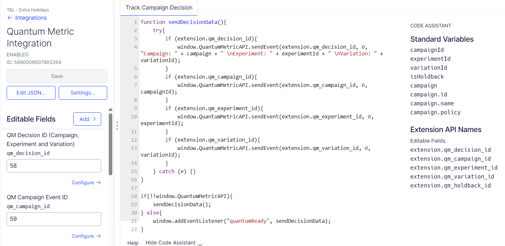

## Quantum Metrics

Custom analytics integration to log decisions to Quantum Metric.

  

### To use

1. Navigate to **Settings** and select the **Integrations** tab.
2. Click on **Create New Analytics Integration** and select **Using JSON**.
3. Paste the provided json into JSON Code box and click **Create Extension**.
4. Enable the newly created integration.